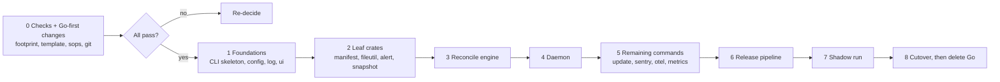

# Plan: rewrite bosun in Rust

- **Status:** Draft, revised after review round 2 (2026-11-26). Nothing
  here is implemented.
- **Decision record:** [ADR-0015](../adr/0015-rust-rewrite.md) (Proposed)
- **Baseline:** `main` at `82f19b7` (2026-11-26)
- **Scope:** the `bosun` binary (`cmd/`, `internal/`) and the Go Dagger
  module (`dagger/`). The web UI (`webui/`), docs site (`site/`), and
  manifest fixtures stay as they are.

## Summary

Rewrite the Go binary in Rust behind a parity harness, then swap releases.
The Go code stays the shipping product until the Rust binary passes every
OpenSpec scenario and a two-week shadow run on the real Unraid host.

Phase 0 decides whether this is worth it, before any porting starts. It
has four checks, each with a pass/fail bar:

1. **Footprint probe.** Measure the Go baseline and a minimal Rust daemon
   skeleton. If Rust cannot clearly beat Go here, the footprint goal fails
   on day 3, not week 20.
2. **User templates.** User repos hold `.tmpl` files written in Go
   `text/template` + Sprig. Rust has no drop-in engine, and bosun allows
   all but 3 of Sprig's functions today.
3. **SOPS.** There is no maintained Rust SOPS library.
4. **Git.** `go-git` plus `x/crypto/ssh` gives in-process host-key and
   redirect control today.

If a check fails its bar, stop and re-decide. Do not port around it.

Phase 0 also lands three changes on the Go side that are worth having even
if the rewrite never happens: age-only SOPS, a trimmed template function
allowlist, and retiring Dagger. Everything after phase 0 is sunk cost if
the port stalls (see [Risks](#risks)).

## Decisions from review (2026-11-26)

Cameron answered the first round of open questions:

| Question | Answer | Effect on the plan |
|----------|--------|--------------------|
| Why Rust? | Safety, interop, a lower footprint, and Rust as the long-term language | See [Motivation, weighed](#motivation-weighed) |
| Template approach | All Rust if we commit | Check 2 is a pure-Rust engine. The WASM option is dropped |
| SOPS key types | Age only | Port is age-only. Other key types fail loudly |
| Windows | Out of scope | Linux and macOS only. The `_windows.go` paths are not ported |

**All Rust** means no Go code bosun owns survives cutover: not in the
binary, not in the build. External tools stay allowed. `docker compose` and
OpenSSH `ssh` are subprocesses today and are not Go code bosun owns. By the
same rule, the `sops` and `git` binaries are allowed too (checks 3 and 4).

**Dagger retires in phase 0**, not phase 6. The Dagger module
(`dagger/main.go`) is Go, Dagger's Rust SDK trails its Go/TS/Python SDKs,
and `.goreleaser.yaml` already has two `TODO`s where Dagger blocks binary
signing and image builds. A new ADR supersedes
[ADR-0003](../adr/0003-dagger-for-bosun.md) (Dagger) and moves the Go
release to plain GitHub Actions. That fixes binary signing on Go today, and
the Rust release reuses the same workflow.

**Go-first spec changes.** Two OpenSpec changes land on the Go binary in
phase 0, so Go and Rust agree before parity testing starts:

- `restrict-sops-to-age`: reject non-age key groups with a clear error.
- `trim-template-funcs`: shrink `allowedSprigFuncs` from 208 names to the
  set real templates use (see check 2). This is a breaking change for any
  template using a dropped function, so it ships with a `bosun lint` rule
  that names the function and the release that removed it.

## Motivation, weighed

Each stated reason, against what it actually buys over Go:

| Reason | What Rust really adds | Verdict |
|--------|----------------------|---------|
| Safety | Go is already memory-safe (`CGO_ENABLED=0`). Rust adds compile-time data-race freedom (`Send`/`Sync`) and no nil. Against that, bosun would own a template engine and possibly a SOPS decryptor, which trades GC and nil bugs for parser and crypto-boundary bugs. `#![forbid(unsafe_code)]` covers bosun's code only; `tokio`, `hyper`, `bollard`, `gix`, and the crypto crates still use `unsafe` | Modest. Real for the daemon's concurrency rules (#793, #792). Offset by any parser or crypto code bosun takes on |
| Footprint | Unknown until measured. The Go binary is ~1/3 of the image; the rest is `docker-cli`, `docker-cli-compose`, `git`, `openssh-client` | Unproven. Check 1 measures it with pass/fail targets |
| Interop | bosun is a standalone CLI and daemon. Go and Rust interop identically over processes, HTTP, and files | None today. Counts only if another Rust project will import bosun crates. None is named |
| Long-term language | Cameron prefers an all-Rust stack and sees Rust as the language to standardize on | **The main reason.** Legitimate, and weighed as a preference, not a technical win |

Stated plainly: this rewrite is mostly a bet on standardizing on Rust. The
footprint goal is the one technical reason that could pay for it, which is
why it is measured first.

### Footprint baseline and targets

Go baseline, `v0.49.10`, measured 2026-11-26:

| Measure | Go baseline | Where measured | Rust target |
|---------|------------:|----------------|-------------|
| Binary, `linux_amd64`, stripped | 57.2 MiB (60.0 MB) | Release asset, extracted | ≤ 25 MiB |
| Release archive, `linux_amd64` | 18.9 MiB | Release asset | ≤ 10 MiB |
| Container image, `linux/amd64`, compressed | 58.2 MiB | GHCR manifest layer sizes | Smaller than Go. The binary layer is 19.0 MiB of the 58.2; the rest is `docker-cli`, compose, `git`, `ssh` |
| Daemon idle RSS | 43.7 MiB | Cloud sandbox: no Docker, failed initial clone, HTTP off | ≤ 50% of the host baseline |
| Daemon idle RSS on the Unraid host | **not yet measured** | Phase 0, check 1 | ≤ 50% of Go |
| Daemon peak RSS during a full reconcile | **not yet measured** | Phase 0, check 1, on the host | ≤ 60% of Go |

The targets are proposals for Cameron to accept or change. The sandbox RSS
is a lower bound; the host number is the one that counts.

**Check 1 (footprint probe)** builds a Rust daemon skeleton that links the
real dependency set (`tokio`, `axum`, `bollard`, `reqwest` + `rustls`,
`gix`, `tracing`, `sentry`, `opentelemetry`) and idles with the same
listeners. If its binary size or idle RSS misses the targets, the footprint
goal is dead, and the decision falls back to the preference alone.

### Other cutover measures

- `unsafe`: every bosun crate sets `#![forbid(unsafe_code)]`, except at
  most one small `bosun-sys` crate for OS calls no safe crate covers (see
  [OS security primitives](#os-security-primitives)). Dependency `unsafe`
  is tracked with `cargo-geiger`, not claimed away.
- Supply chain: `cargo-deny` (licenses, advisories, duplicate crates) and
  `cargo-audit` in CI.

## What we are porting

Line counts at the baseline (`.go` files, comments included):

| Package | Source | Tests | Notes |
|---------|-------:|------:|-------|
| `internal/reconcile` | 18,815 | 40,470 | GitOps engine. The bulk of the risk. |
| `internal/cmd` | 11,446 | 14,165 | 28 command files (Cobra) |
| `internal/daemon` | 7,143 | 15,236 | Webhooks, socket API, single-flight |
| `internal/manifest` | 3,180 | 5,072 | Manifest render, deep merge, chart templating |
| `internal/fileutil` | 2,079 | 4,296 | Atomic writes, content-hash sync |
| `internal/alert` | 1,573 | 2,475 | Discord, SendGrid, Twilio |
| `internal/config` | 1,540 | 3,879 | `bosun.yaml` discovery and parsing |
| `internal/docker` | 1,520 | 3,709 | moby client wrapper, compose exec |
| Everything else | ~4,300 | ~9,000 | lock, log, ui, tunnel, update, snapshot, sentry, telemetry, retry, deadline, preflight |
| **Total** | **~51,600** | **~98,000** | |

The Go tests are mostly white-box (package internals, testify, mocks).
They do not port mechanically. Section [Tests](#tests) covers what does.

## Contracts that must not change

These are what users and their hosts depend on. The rewrite is "done" only
when each one matches the Go binary byte for byte or by spec.

| Contract | Where it lives | How parity is checked |
|----------|----------------|-----------------------|
| CLI commands, flags, exit codes, `--help` | `internal/cmd`, `docs/cli-reference.md` | Golden diff of both binaries |
| `bosun.yaml` schema and precedence | `internal/config` | Shared fixtures, both binaries |
| 71 `BOSUN_*` env vars, legacy aliases, defaults | `AGENTS.md` table | Generated test per row |
| Template language for user `.tmpl` files | `internal/reconcile/template*.go` | Differential render (check 2) |
| Manifest/provision render output | `internal/manifest` | Golden diff on `manifest/`, `examples/` |
| SOPS file formats: YAML, JSON, dotenv, INI | `internal/reconcile/sops.go` | Vectors from the real `sops` binary (check 3) |
| On-disk state: `deploy-state.json`, snapshots, backups | `reconcile/state.go`, `snapshot` | Rust reads Go files **and** Go reads Rust files |
| Socket and HTTP API, webhook signatures, status codes | `internal/daemon` | Black-box HTTP suite against both |
| Metric names, log JSON field names | `daemon`, `log` | Scrape and log diff |
| Release asset names: `bosun_{ver}_{os}_{arch}.tar.gz`, `checksums.txt` | `.goreleaser.yaml` | The last Go release must self-update into the first Rust one |
| Container image name, tags, runtime deps | `bosun/Dockerfile` | Same image, swapped binary |

The release-asset row is easy to miss. `bosun update` on the last Go
version picks the archive by that name pattern and verifies it against
`checksums.txt`. If the Rust release names assets differently, every
existing install strands on Go.

Any intended behavior change (for example, age-only SOPS) is a spec
change. It needs an `openspec/changes/<id>/` proposal first, per
`AGENTS.md` § Spec Before Code.

## Phase 0 checks

Each check is a throwaway branch with a written result in this file. Check
1 (footprint) is above. Checks 3 and 4 take about 3 working days each.
Check 2 takes about 2 weeks, because it includes the usage survey and the
Go-first trim.

### Check 2: Go template compatibility

User templates use Go syntax, Sprig functions, and bosun's own functions
(`include` and `fromJsonFile` in reconcile; `include`, `nindent`, and
`toYaml` in manifest chart templating). Literal escapes like
`{{ "{{ normalize .Name }}" }}` in `examples/` must render exactly.

Options:

| Option | Keeps user contract | Cost |
|--------|--------------------|------|
| **A. Go-compatible engine in Rust** (write one; `gtmpl` is largely dormant) | Yes | See scope below |
| B. Switch to `minijinja` and ship a converter | No. Breaks every user repo and [ADR-0011](../adr/0011-helm-alignment.md) (Helm alignment) | Converter plus a migration window |

**Chosen: A** (all Rust). If A misses the bar, the choice is B (a
breaking change for every user repo) or staying on Go. That goes back to
Cameron.

**Scope is larger than a spike.** `allowedSprigFuncs` in
`internal/reconcile/template_funcs.go` is every Sprig v3.3.0 function
except `env`, `expandenv`, and `getHostByName`: 208 names. That includes
X.509 generation (`genCA`, `genSignedCert`), password and crypto helpers
(`bcrypt`, `htpasswd`, `encryptAES`, `derivePassword`), Go reference-time
date layouts (`date`, `dateInZone`, `toDate`), reflection (`typeOf`,
`kindIs`), and Masterminds `semverCompare`, which differs from the Rust
`semver` crate. On top of that: `missingkey=error` (manifest templating),
Go `printf` verbs, `define`/`template`/`block`, pipelines, `{{-` trim,
sorted map `range`, and Go truthiness.

So check 2 has three steps:

1. **Survey** which functions real templates use: `examples/`,
   `manifest/`, test fixtures, and Cameron's live infra repo. The checked-in
   corpus uses almost none (`indent`, plus bosun's own `include`).
2. **Trim on Go first** through `trim-template-funcs`: keep the used set
   plus a small, common core (strings, lists, dicts, defaults, encoding).
   Target: 20–40 functions. Anything else is a spec change to add back.
3. **Build the core engine** (parse, execute, trim, pipelines, the trimmed
   functions) far enough to render the corpus.

Budget for the full engine after check 2: 4–6 weeks in phase 2, not 3
days. Without the trim, the engine is a multi-month project of its own and
check 2 fails.

**Pass bar:** byte-identical output against Go on every template in
`examples/`, `manifest/`, the test fixtures, and Cameron's live infra repo.
Then, once the engine is complete in phase 2, 24 hours of differential fuzzing (same template + data into both
engines) with zero diffs, or only diffs we choose to accept and spec.

### Check 3: SOPS decryption

bosun calls `decrypt.File` and validates an age identity first. Scope is
**age only** (Cameron, 2026-11-26). PGP, AWS/GCP KMS, Azure Key Vault, and
HashiCorp Vault key groups fail with a clear error. The
`restrict-sops-to-age` spec change lands on Go first.

| Option | What bosun owns | Cost |
|--------|-----------------|------|
| **A. Shell out to a pinned `sops` binary** (`sops decrypt --output-type json`) | Error mapping from exit code and stderr, a version pin, and the age identity check that already exists | `sops` becomes a runtime dependency: added to the image, checked by `bosun doctor`, and required on bare-metal installs. The `sops` binary is itself a large Go binary, so it eats into the image-size goal. Plaintext crosses a pipe to a child process, which [ADR-0010](../adr/0010-go-rewrite.md) moved away from |
| B. Own decryptor on `age` + `aes-gcm` | Age-wrapped data key, `ENC[AES256_GCM,...]` values with the key path as AAD, MAC check, 4 formats, `unencrypted_suffix`, `mac_only_encrypted`, and `sops.go`'s non-leaking error boundary | A high-liability crypto subsystem to own forever |

**Lean: A.** It follows the same rule that allows `ssh` and `docker
compose`, and it keeps crypto in upstream's hands. B stays possible later,
behind the same tests, if dropping the runtime dependency becomes worth it.
This reverses ADR-0010's "no sops CLI" choice, so it needs Cameron's
explicit yes.

**Pass bar (either option):** decrypts every vector produced by the real `sops` binary for
all four formats, including nested keys, `unencrypted_suffix`, and
`mac_only_encrypted`. Fails closed with the same error classes as
`sops.go` (`ErrSOPSIntegrity`, `ErrSOPSKeyUnavailable`, and the others) on
tampered values, wrong keys, and truncated files. No decrypted value,
data key, or MAC appears in an error, log line, or stderr passthrough.

### Check 4: Git transport

Today: in-process clone/fetch, HTTPS Basic auth with redirect-downgrade
refusal, and SSH with fail-closed `known_hosts` (PR #712).

| Option | HTTPS redirect and credential control | SSH host-key control | Cost |
|--------|---------------------------------------|----------------------|------|
| `gix` (gitoxide) + system `ssh` | In-process, but whether `gix`'s HTTP transport can enforce "same-origin HTTPS only, never forward Basic auth cross-origin" is **unverified** | `-o StrictHostKeyChecking=yes -o UserKnownHostsFile=...`, as deploy already does in `reconcile/ssh.go` | Pure Rust; typed diff-base and shallow-fetch logic |
| `git` CLI + system `ssh` | Through `git` config (`http.followRedirects`, credential helper or `GIT_ASKPASS`, never userinfo in URLs). Cross-origin behavior also **unverified** | Same `ssh` flags via `GIT_SSH_COMMAND` | Least code. Output parsing for diffs. `git` is already in the image |
| `git2` (libgit2 + libssh2) | In-process callbacks | In-process callbacks | C deps; static musl builds get harder |

Once `gix` shells out to `ssh`, its edge over the `git` CLI is in-process
HTTPS control and typed results, not SSH. If check 4 cannot prove that
`gix` enforces the redirect rule, the `git` CLI wins on less code. Check 4
runs the same pass bar against both and picks the one that passes with less
owned code. the existing Git trust scenarios in
`openspec/specs/reconcile/spec.md` pass. That covers missing or malformed
`known_hosts`, agent vs. key fallback, the insecure opt-out, HTTPS
credential pairing, and cross-origin redirect refusal. Shallow fetch with
`BOSUN_GIT_FETCH_DEPTH` and the diff-base fallback must work too.

## Crate map

| Go dependency | Rust choice | Risk |
|---------------|-------------|------|
| `cobra` | `clap` (derive) + `clap_complete` | Low |
| `moby/moby/client` | `bollard` | Low. Keep a `DockerApi` trait so tests mock it, as today |
| `docker compose` exec | `tokio::process` | Low. Already a subprocess |
| `go-git` + `x/crypto/ssh` | `gix` or `git` CLI, plus system `ssh` | High (check 4) |
| `getsops/sops` | pinned `sops` binary, or own crate on `age` + `aes-gcm` | High (check 3) |
| `text/template` + `sprig` | own engine | Highest (check 2) |
| `yaml.v3` | A parser (`saphyr` or a maintained `serde_yaml` fork such as `serde_norway`) **plus a small owned emitter** | Medium-high. `serde_norway` drops comments and anchors and orders keys differently from `yaml.v3`; `saphyr` is a lower-level parser, not a serde drop-in. Byte-stable `toYaml` and deep-merge output need bosun's own emitter |
| `doublestar` | `globset` or `wax` | Medium. `**` edge cases differ. Differential test it |
| `zerolog` | `tracing` + `tracing-subscriber` JSON | Low. Keep field names |
| `fatih/color` | `anstream` / `owo-colors` | Low |
| `net/http` server | `axum` on `tokio`, `hyper-util` for the Unix socket | Medium |
| `x/sys` peer creds | `tokio::net::UnixStream::peer_cred` | Low |
| `flock` / `LockFileEx` | `fs4` | Low |
| `go-selfupdate` | hand-rolled on `reqwest` + `sha2` | Medium. The spec's fail-closed checksum rules are strict; a small owned module is easier to prove |
| `client_golang` | `prometheus-client` | Low. Metric names frozen |
| `sentry-go` | `sentry` | Low |
| OpenTelemetry | `opentelemetry` + `opentelemetry-otlp` (HTTP) | Medium. Crate API churns |
| `x/term` (TTY checks, prompts in `init`, color in `log`) | `std::io::IsTerminal` + `rpassword` or `dialoguer` | Low |
| `shellquote`, `uuid`, `Masterminds/semver` | `shlex`, `uuid`, `semver` | Low. Only `semver` parsing; `semverCompare` in templates is check 2's problem |
| OTLP protobuf | `opentelemetry-proto` (via `opentelemetry-otlp`) | Low |

Platforms: `x86_64` and `aarch64` for Linux (musl, static) and macOS.
Windows is out of scope (Cameron, 2026-11-26). The Go `_windows.go` files
are not ported.

## OS security primitives

`internal/reconcile` relies on OS-level controls that have no line in a
dependency list. Each must survive the port, on Linux musl and macOS, with
its existing tests ported first.

| Control | Go today | Rust mapping | Safe? |
|---------|----------|--------------|-------|
| Pinned-directory confinement and symlink refusal (TOCTOU) | `*os.Root` in `template.go` (`sourceRoot`, `includeRoot`), `open_pinned_other.go`; tests `deploy_pinned_root_test.go`, `template_include_root_unix_test.go`, `template_symlink_refusal_test.go`, `lock_confinement_errors_unix_test.go` | `cap-std` `Dir` (openat-based, refuses escapes) | Safe API. Verify symlink-refusal semantics match `os.Root` |
| No-clobber atomic rename, Linux | `renameat2(RENAME_NOREPLACE)` in `rename_noreplace_linux.go` | `rustix::fs::renameat_with(.., RenameFlags::NOREPLACE)` | Safe API |
| No-clobber atomic rename, macOS | `renamex_np` / `renameatx_np` with `RENAME_EXCL` in `rename_noreplace_darwin.go` | Verify `rustix` coverage. If missing, the one `bosun-sys` crate wraps it | Possibly `unsafe`, isolated |
| Process-group cancellation of `docker compose` | `Setpgid`, then `kill(-pgid, SIGTERM)` then `SIGKILL` in `compose_cancel_unix.go` | `std::os::unix::process::CommandExt::process_group(0)` + `rustix::process::kill_process_group` | Safe API |
| Transfer file identity (dev, inode) | `syscall.Stat_t` in `transfer_identity_unix.go` | `std::os::unix::fs::MetadataExt` | Safe API |
| Unix socket peer UID | `x/sys` peer credentials | `tokio::net::UnixStream::peer_cred` | Safe API |

Phase 1 verifies each row on both platforms before phase 3 depends on it.
If any row needs `unsafe`, it lives in `bosun-sys` only, with its own tests,
and every other crate keeps `#![forbid(unsafe_code)]`.

## Layout

One Cargo workspace at the repo root, next to `go.mod`, until cutover.

```text
Cargo.toml              # workspace
crates/
  bosun/                # bin: clap commands (internal/cmd)
  bosun-core/           # config, ui, log, lock, fileutil, retry, deadline
  bosun-template/       # Go-compatible template engine (check 2)
  bosun-sops/           # SOPS decrypt or sops CLI wrapper (check 3)
  bosun-sys/            # only if needed: the OS calls no safe crate covers
  bosun-manifest/       # manifest render, deep merge
  bosun-reconcile/      # engine, git, ssh, docker, compose, backup, hooks
  bosun-daemon/         # HTTP, socket, webhooks, drift loop
  bosun-alert/          # providers
parity/                 # harness that runs Go and Rust binaries side by side
```

Few crates on purpose. Split only where a crate has a clean API and its own
test vectors (template, sops). Everything async runs on `tokio`.

## Phases



Each phase ends with its parity checks green in CI. Estimates assume
agent-driven implementation with Cameron reviewing. Confidence is low until
phase 0 lands.

| # | Phase | Exit check | Estimate |
|---|-------|-----------|----------|
| 0 | Four checks; `restrict-sops-to-age`, `trim-template-funcs`, and Dagger retirement land on Go | Four pass bars above; Go release green on plain Actions | 3 weeks |
| 1 | Foundations: workspace, `clap` tree matching every command and flag, config load, env table, `ui`, `log`, lock, OS primitives verified | `--help` and config golden diffs match; OS primitive tests pass on Linux and macOS | 2 weeks |
| 2 | Leaf crates: template engine, YAML emitter, manifest render, `fileutil`, snapshot, alert providers, tunnel | Template differential fuzzing clean; manifest golden diffs; alert payload snapshots match | 6–8 weeks |
| 3 | Reconcile engine: the 9-step pipeline, multi-target, backup/rollback, health gate, restart breaker, hooks, drift | All `reconcile` and `reconcile-fuse-hooks` scenarios pass; state files round-trip with Go | 6–8 weeks |
| 4 | Daemon: socket (0660 staged publish, peer UID), webhooks (HMAC, 1 MiB cap, fail-closed), single-flight with counted coalescing, drift loop, self-heal | Black-box HTTP suite passes against both binaries | 3–4 weeks |
| 5 | Remaining commands and services: `update`, `doctor`, `status`, `crew`, `yacht`, `mayday`, `migrate`, Sentry, OTel, metrics | Every CLI golden and the `self-update`/`observability` scenarios pass | 2–3 weeks |
| 6 | Release: Rust build in the Actions release workflow from phase 0 (GoReleaser OSS `builder: rust`, which uses `cargo-zigbuild`), Cosign on binaries and image, same asset names, same image | A pre-release tag self-updates from the last Go release in a test container | 1 week |
| 7 | Shadow run on the Unraid host (below) | Two weeks, zero unexplained diffs | 2 weeks elapsed |
| 8 | Cutover and Go removal | One clean release cycle on Rust | 1–2 weeks elapsed |

Rough total: **26–33 weeks** of calendar time, about 6–8 months. The first
estimate (12–16 weeks) left 8–12 weeks for 51.6k lines, 493 scenarios, a
template engine, and a moving `main`. That was optimistic by about 2x.

## Tests

The OpenSpec scenarios are the acceptance list: **493 scenarios** across
10 specs (`reconcile` alone has 210). The plan:

1. Give every scenario a stable ID and a Rust test that names it. A CI check
   fails if any scenario has no test.
2. Port the Go regression tests that pin a numbered bug (`#368`, `#391`,
   `#727`, `#792`, `#793`, and others). They encode failures the specs may
   not.
3. Run differential tests wherever there is a pure function: templates,
   SOPS, glob matching, YAML merge, config parsing, duration parsing. Use
   `proptest` input against both implementations.
4. Use `insta` snapshots for CLI output and alert payloads.
5. Keep the shell tests (`scripts/*_test.sh`) and the workflow contract
   tests. Port `internal/workflowcontract` to a Rust test crate or a small
   script, since it only reads YAML.
6. Coverage moves to `cargo llvm-cov`. Keep the 80% patch gate in
   `codecov.yml`.

### Agent resource gate

`scripts/agent-go-gate.sh` is Go-specific. Rust `target/` dirs are large,
and a cold build of this workspace may exceed the gate's 4 GiB disk delta.
Phase 1 adds a cargo variant: one shared `CARGO_TARGET_DIR` across
worktrees, the same lock and free-space floor, and a delta cap tuned from a
measured cold build. Agents must not create per-worktree target dirs.

## Concurrency invariants to carry over

These are subtle in Go today and easy to lose in a port. Each gets a
dedicated test before phase 4 closes.

- `reconcileMu` is never held across I/O (#793). In Rust: use
  `std::sync::Mutex` (or `parking_lot::Mutex` without `send_guard`), not
  `tokio::sync::Mutex`. A `tokio` guard is `Send`, so the compiler allows it
  across `.await`. A `std` guard is `!Send`, so a future that holds it
  across `.await` cannot be passed to `tokio::spawn`, and the build fails.
  Back it with `clippy::await_holding_lock` set to `deny`.
- Triggers during a run form one follow-up batch, with sorted distinct
  sources and sticky `force`.
- Async reconciles are daemon-owned: they get shutdown cancellation, not
  request cancellation. In Rust: a `JoinSet` plus a daemon-level
  `CancellationToken`.
- Drift skips while a trigger waits. `drifting` clears even on panic. In
  Rust: a drop guard.
- A dry run persists no state (#792). Route every write through one
  `persist_state` that checks `dry_run`.

## Keeping up with Go during the port

`main` moves fast (PR #889 at baseline). The port tracks a moving target.

- Freeze the baseline SHA per phase. When a phase starts, rebase its parity
  fixtures onto current `main`.
- Any Go behavior change after the baseline must land with a spec scenario.
  The scenario-coverage check then flags it as missing in Rust.
- Hold large Go features until phase 3 is done, or accept the double work.

## Shadow run and cutover

1. **Shadow.** Run the Rust daemon on the Unraid host next to the Go
   daemon, with `DryRun` on, its own state dir, and a different socket and
   port. Both receive the same webhooks. A small script diffs, per cycle:
   the planned deploy file set, compose files selected, hooks chosen, and
   drift findings.
2. **Swap.** Publish the first Rust release under the same asset names and
   image. Go installs reach it through `bosun update`, `upgrade-bosun.sh`,
   or an image pull.
3. **Rollback.** Pin the image tag or install the last Go release. This
   only works if Go can read state the Rust binary wrote, which is why the
   state round-trip test runs both ways.
4. **Delete Go.** After one clean release cycle, remove `cmd/`,
   `internal/`, `go.mod`, the Go CI jobs, and `.golangci.yml`. Update
   `AGENTS.md`, `llms.txt`, the onboard skill, and the docs that name Go
   packages.

## Risks

| Risk | Impact | Mitigation |
|------|--------|-----------|
| Template engine diverges in a rare case | User configs render wrong, silently | Check 2 bar plus ongoing differential fuzzing in CI |
| SOPS edge case decrypts wrong or fails open | Secret exposure or broken deploys | Fail-closed error classes; vectors from real `sops`; tamper tests |
| SSH trust regression | MITM on Git or deploy | Reuse the #712 scenarios; system `ssh` with strict flags |
| Port stalls mid-way | Sunk cost. A rewrite has no useful partial artifact: stalling in phase 3 leaves ~30k lines of unshipped Rust next to Go, and it gets deleted | Front-load what pays off anyway (the three Go-first changes in phase 0). Hold a go/no-go review at the end of phases 0, 2, and 3, and name the stop condition before each one starts |
| `main` keeps moving | Parity never converges | Spec-scenario check; freeze large features during phase 3 |
| Rust build disk use | Agent gate rejects work | Cargo gate variant in phase 1 |
| Template trim breaks a user template | A deploy fails at render time | `bosun lint` rule names the removed function; trim lands on Go months before cutover |
| `sops` CLI drift (if check 3 picks option A) | Error mapping breaks on an upgrade | Pin the version in the image and in `bosun doctor`; test against the pinned version |

## Open decisions

The first round is answered (see [Decisions](#decisions-from-review-2026-11-26)).
These are decided inside a phase, not up front:

1. **Footprint targets** (now): accept or change the targets in
   [Footprint baseline and targets](#footprint-baseline-and-targets).
2. **SOPS** (check 3): approve shelling out to `sops`, which reverses
   ADR-0010's "no sops CLI" choice.
3. **Git** (check 4): `gix` or the `git` CLI, picked by the pass bar.
4. **YAML parser** (phase 1): `saphyr` or a `serde_yaml` fork, under an
   owned emitter.
5. **Glob crate** (phase 1): `globset` or `wax`, picked by differential
   tests against `doublestar`.

## Not in scope

- Implementing any phase. This PR is the plan only.
- Changing the web UI, docs site, or manifest format.
- New features. Parity first; improvements after cutover.
