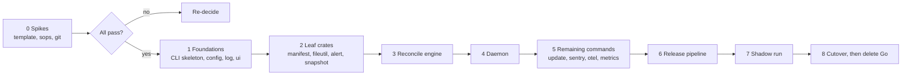

# Plan: rewrite bosun in Rust

- **Status:** Draft, for review. Nothing here is implemented.
- **Decision record:** [ADR-0015](../adr/0015-rust-rewrite.md) (Proposed)
- **Baseline:** `main` at `82f19b7` (2026-11-26)
- **Scope:** the `bosun` binary (`cmd/`, `internal/`) and the Go Dagger
  module (`dagger/`). The web UI (`webui/`), docs site (`site/`), and
  manifest fixtures stay as they are.

## Summary

Rewrite the Go binary in Rust behind a parity harness, then swap releases.
The Go code stays the shipping product until the Rust binary passes every
OpenSpec scenario and a two-week shadow run on the real Unraid host.

Three Go-native pieces decide whether this is worth it. Each gets a spike
with a pass/fail bar **before** any other porting starts:

1. **User templates.** User repos hold `.tmpl` files written in Go
   `text/template` + Sprig. Rust has no drop-in engine.
2. **SOPS.** There is no maintained Rust SOPS library.
3. **Git over SSH.** `go-git` plus `x/crypto/ssh` gives in-process host-key
   control today. The Rust options are weaker or pull in C.

If a spike fails its bar, stop and re-decide. Do not port around it.

## Decisions from review (2026-11-26)

Cameron answered the first round of open questions:

| Question | Answer | Effect on the plan |
|----------|--------|--------------------|
| Why Rust? | Safety, interop, a lower footprint, and Rust as the long-term language | Cutover measures these (below) |
| Template approach | All Rust if we commit | Spike 1 is a pure-Rust engine. The WASM option is dropped |
| SOPS key types | Age only | Port is age-only. Other key types fail loudly |
| Windows | Out of scope | Linux and macOS only. The `_windows.go` paths are not ported |

**All Rust** means no Go code we own survives cutover: not in the binary,
not in the build. Two consequences:

- The Dagger module (`dagger/main.go`) is Go. Phase 6 either ports it to
  the Dagger Rust SDK or retires Dagger. Retiring it needs an ADR that
  supersedes [ADR-0003](../adr/0003-dagger-for-bosun.md) (Dagger).
- External tools stay allowed. `docker compose` and OpenSSH `ssh` are
  already subprocesses today and are not Go code bosun owns.

**What cutover measures**, against the last Go release on the same host:

- Daemon memory: idle RSS and peak RSS during a full reconcile.
- Binary size and container image size.
- `unsafe`: every bosun crate sets `#![forbid(unsafe_code)]`. Dependencies
  with `unsafe` are listed in the release notes, reviewed via `cargo-geiger`.
- Supply chain: `cargo-deny` (licenses, advisories, duplicate crates) and
  `cargo-audit` in CI.

**Age-only SOPS lands on Go first.** An OpenSpec change (working name
`restrict-sops-to-age`) makes the Go binary reject non-age key groups with a
clear error. Then Go and Rust agree, and the parity harness has no known
diff to carry.

## What we are porting

Line counts at the baseline (`.go` files, comments included):

| Package | Source | Tests | Notes |
|---------|-------:|------:|-------|
| `internal/reconcile` | 18,815 | 40,470 | GitOps engine. The bulk of the risk. |
| `internal/cmd` | 11,446 | 14,165 | 28 command files (Cobra) |
| `internal/daemon` | 7,143 | 15,236 | Webhooks, socket API, single-flight |
| `internal/manifest` | 3,180 | 5,072 | Manifest render, deep merge, chart templating |
| `internal/fileutil` | 2,079 | 4,296 | Atomic writes, content-hash sync |
| `internal/alert` | 1,573 | 2,475 | Discord, SendGrid, Twilio |
| `internal/config` | 1,540 | 3,879 | `bosun.yaml` discovery and parsing |
| `internal/docker` | 1,520 | 3,709 | moby client wrapper, compose exec |
| Everything else | ~4,300 | ~9,000 | lock, log, ui, tunnel, update, snapshot, sentry, telemetry, retry, deadline, preflight |
| **Total** | **~51,600** | **~98,000** | |

The Go tests are mostly white-box (package internals, testify, mocks).
They do not port mechanically. Section [Tests](#tests) covers what does.

## Contracts that must not change

These are what users and their hosts depend on. The rewrite is "done" only
when each one matches the Go binary byte for byte or by spec.

| Contract | Where it lives | How parity is checked |
|----------|----------------|-----------------------|
| CLI commands, flags, exit codes, `--help` | `internal/cmd`, `docs/cli-reference.md` | Golden diff of both binaries |
| `bosun.yaml` schema and precedence | `internal/config` | Shared fixtures, both binaries |
| 71 `BOSUN_*` env vars, legacy aliases, defaults | `AGENTS.md` table | Generated test per row |
| Template language for user `.tmpl` files | `internal/reconcile/template*.go` | Differential render (Spike 1) |
| Manifest/provision render output | `internal/manifest` | Golden diff on `manifest/`, `examples/` |
| SOPS file formats: YAML, JSON, dotenv, INI | `internal/reconcile/sops.go` | Vectors from the real `sops` binary (Spike 2) |
| On-disk state: `deploy-state.json`, snapshots, backups | `reconcile/state.go`, `snapshot` | Rust reads Go files **and** Go reads Rust files |
| Socket and HTTP API, webhook signatures, status codes | `internal/daemon` | Black-box HTTP suite against both |
| Metric names, log JSON field names | `daemon`, `log` | Scrape and log diff |
| Release asset names: `bosun_{ver}_{os}_{arch}.tar.gz`, `checksums.txt` | `.goreleaser.yaml` | The last Go release must self-update into the first Rust one |
| Container image name, tags, runtime deps | `bosun/Dockerfile` | Same image, swapped binary |

The release-asset row is easy to miss. `bosun update` on the last Go
version picks the archive by that name pattern and verifies it against
`checksums.txt`. If the Rust release names assets differently, every
existing install strands on Go.

Any intended behavior change (for example, age-only SOPS) is a spec
change. It needs an `openspec/changes/<id>/` proposal first, per
`AGENTS.md` § Spec Before Code.

## Spikes (phase 0)

Each spike is a throwaway branch with a written result in this file.
Budget: about 3 working days each, run in parallel.

### Spike 1: Go template compatibility

User templates use Go syntax, Sprig functions, and bosun's own functions
(`include` and `fromJsonFile` in reconcile; `include`, `nindent`, and
`toYaml` in manifest chart templating). Literal escapes like
`{{ "{{ normalize .Name }}" }}` in `examples/` must render exactly.

Options:

| Option | Keeps user contract | Cost |
|--------|--------------------|------|
| **A. Go-compatible engine in Rust** (extend the `gtmpl` crate or write one) | Yes | 3–5k lines: pipelines, `range`/`with`/`else if`, `define`/`template`/`block`, `{{-` trim, sorted map `range`, Go truthiness, plus the Sprig subset bosun allows |
| B. Switch to `minijinja` and ship a converter | No. Breaks every user repo and [ADR-0011](../adr/0011-helm-alignment.md) (Helm alignment) | Converter plus a migration window |

**Chosen: A** (all Rust). If A misses the bar, the choice is B (a
breaking change for every user repo) or staying on Go. That goes back to
Cameron.

**Pass bar:** byte-identical output against Go on every template in
`examples/`, `manifest/`, the test fixtures, and Cameron's live infra repo.
Then 24 hours of differential fuzzing (same template + data into both
engines) with zero diffs, or only diffs we choose to accept and spec.

### Spike 2: SOPS decryption

bosun calls `decrypt.File` and validates an age identity first. The Rust
port would implement SOPS decrypt directly: age-wrapped data key,
`ENC[AES256_GCM,...]` values with the key path as AAD, and MAC check. The
`age` and `aes-gcm` crates are mature.

Scope: **age only** (Cameron, 2026-11-26). PGP, AWS/GCP KMS, Azure Key
Vault, and HashiCorp Vault key groups fail with a clear error. The
`restrict-sops-to-age` spec change lands on Go first (see Decisions).

**Pass bar:** decrypts every vector produced by the real `sops` binary for
all four formats, including nested keys, `unencrypted_suffix`, and
`mac_only_encrypted`. Fails closed with the same error classes as
`sops.go` (`ErrSOPSIntegrity`, `ErrSOPSKeyUnavailable`, and the others) on
tampered values, wrong keys, and truncated files.

### Spike 3: Git transport

Today: in-process clone/fetch, HTTPS Basic auth with redirect-downgrade
refusal, and SSH with fail-closed `known_hosts` (PR #712).

| Option | HTTPS | SSH host-key control | Cost |
|--------|-------|----------------------|------|
| **`gix` (gitoxide)** + system `ssh` | Native, pure Rust | Pass `-o StrictHostKeyChecking=yes -o UserKnownHostsFile=...`, the same way remote deploy already shells out in `reconcile/ssh.go` | The image already ships `openssh-client` |
| `git2` (libgit2 + libssh2) | Yes | In-process callbacks | C deps; static musl builds get harder |
| `gix` + `russh` custom transport | Native | In-process | Most code to own |

**Lean: `gix` + system `ssh`.** It matches how deploy already works and
keeps the binary pure Rust.

**Pass bar:** the existing Git trust scenarios in
`openspec/specs/reconcile/spec.md` pass. That covers missing or malformed
`known_hosts`, agent vs. key fallback, the insecure opt-out, HTTPS
credential pairing, and cross-origin redirect refusal. Shallow fetch with
`BOSUN_GIT_FETCH_DEPTH` and the diff-base fallback must work too.

## Crate map

| Go dependency | Rust choice | Risk |
|---------------|-------------|------|
| `cobra` | `clap` (derive) + `clap_complete` | Low |
| `moby/moby/client` | `bollard` | Low. Keep a `DockerApi` trait so tests mock it, as today |
| `docker compose` exec | `tokio::process` | Low. Already a subprocess |
| `go-git` + `x/crypto/ssh` | `gix` + system `ssh` | High (Spike 3) |
| `getsops/sops` | own crate on `age` + `aes-gcm` | High (Spike 2) |
| `text/template` + `sprig` | own engine or `gtmpl` | Highest (Spike 1) |
| `yaml.v3` | `serde_yaml` is unmaintained. Pick a fork (`serde_norway`) or `saphyr` in phase 1 | Medium. `toYaml` and merge output must stay byte-stable |
| `doublestar` | `globset` or `wax` | Medium. `**` edge cases differ. Differential test it |
| `zerolog` | `tracing` + `tracing-subscriber` JSON | Low. Keep field names |
| `fatih/color` | `anstream` / `owo-colors` | Low |
| `net/http` server | `axum` on `tokio`, `hyper-util` for the Unix socket | Medium |
| `x/sys` peer creds | `tokio::net::UnixStream::peer_cred` | Low |
| `flock` / `LockFileEx` | `fs4` | Low |
| `go-selfupdate` | hand-rolled on `reqwest` + `sha2` | Medium. The spec's fail-closed checksum rules are strict; a small owned module is easier to prove |
| `client_golang` | `prometheus-client` | Low. Metric names frozen |
| `sentry-go` | `sentry` | Low |
| OpenTelemetry | `opentelemetry` + `opentelemetry-otlp` (HTTP) | Medium. Crate API churns |
| `shellquote`, `uuid`, `semver` | `shlex`, `uuid`, `semver` | Low |

Platforms: `x86_64` and `aarch64` for Linux (musl, static) and macOS.
Windows is out of scope (Cameron, 2026-11-26). The Go `_windows.go` files
are not ported.

## Layout

One Cargo workspace at the repo root, next to `go.mod`, until cutover.

```text
Cargo.toml              # workspace
crates/
  bosun/                # bin: clap commands (internal/cmd)
  bosun-core/           # config, ui, log, lock, fileutil, retry, deadline
  bosun-template/       # Go-compatible template engine (Spike 1)
  bosun-sops/           # SOPS decrypt (Spike 2)
  bosun-manifest/       # manifest render, deep merge
  bosun-reconcile/      # engine, git, ssh, docker, compose, backup, hooks
  bosun-daemon/         # HTTP, socket, webhooks, drift loop
  bosun-alert/          # providers
parity/                 # harness that runs Go and Rust binaries side by side
```

Few crates on purpose. Split only where a crate has a clean API and its own
test vectors (template, sops). Everything async runs on `tokio`.

## Phases



Each phase ends with its parity checks green in CI. Estimates assume
agent-driven implementation with Cameron reviewing. Confidence is low until
the spikes land.

| # | Phase | Exit check | Estimate |
|---|-------|-----------|----------|
| 0 | Spikes | Three pass bars above | 1 week (parallel) |
| 1 | Foundations: workspace, `clap` tree matching every command and flag, config load, env table, `ui`, `log`, lock | `--help` and config golden diffs match | 1 week |
| 2 | Leaf crates: manifest render, `fileutil`, snapshot, alert providers, tunnel | Manifest golden diffs; alert payload snapshots match | 1–2 weeks |
| 3 | Reconcile engine: the 9-step pipeline, multi-target, backup/rollback, health gate, restart breaker, hooks, drift | All `reconcile` and `reconcile-fuse-hooks` scenarios pass; state files round-trip with Go | 3–4 weeks |
| 4 | Daemon: socket (0660 staged publish, peer UID), webhooks (HMAC, 1 MiB cap, fail-closed), single-flight with counted coalescing, drift loop, self-heal | Black-box HTTP suite passes against both binaries | 2 weeks |
| 5 | Remaining commands and services: `update`, `doctor`, `status`, `crew`, `yacht`, `mayday`, `migrate`, Sentry, OTel, metrics | Every CLI golden and the `self-update`/`observability` scenarios pass | 1–2 weeks |
| 6 | Release: goreleaser Rust builder (or `cargo-zigbuild`), Cosign, same asset names, same image. Port the Dagger module to Rust or retire Dagger | A pre-release tag self-updates from the last Go release in a test container | 3–5 days |
| 7 | Shadow run on the Unraid host (below) | Two weeks, zero unexplained diffs | 2 weeks elapsed |
| 8 | Cutover and Go removal | One clean release cycle on Rust | 1–2 weeks elapsed |

Rough total: **12–16 weeks** of calendar time.

## Tests

The OpenSpec scenarios are the acceptance list: **493 scenarios** across
10 specs (`reconcile` alone has 210). The plan:

1. Give every scenario a stable ID and a Rust test that names it. A CI check
   fails if any scenario has no test.
2. Port the Go regression tests that pin a numbered bug (`#368`, `#391`,
   `#727`, `#792`, `#793`, and others). They encode failures the specs may
   not.
3. Run differential tests wherever there is a pure function: templates,
   SOPS, glob matching, YAML merge, config parsing, duration parsing. Use
   `proptest` input against both implementations.
4. Use `insta` snapshots for CLI output and alert payloads.
5. Keep the shell tests (`scripts/*_test.sh`) and the workflow contract
   tests. Port `internal/workflowcontract` to a Rust test crate or a small
   script, since it only reads YAML.
6. Coverage moves to `cargo llvm-cov`. Keep the 80% patch gate in
   `codecov.yml`.

### Agent resource gate

`scripts/agent-go-gate.sh` is Go-specific. Rust `target/` dirs are large,
and a cold build of this workspace may exceed the gate's 4 GiB disk delta.
Phase 1 adds a cargo variant: one shared `CARGO_TARGET_DIR` across
worktrees, the same lock and free-space floor, and a delta cap tuned from a
measured cold build. Agents must not create per-worktree target dirs.

## Concurrency invariants to carry over

These are subtle in Go today and easy to lose in a port. Each gets a
dedicated test before phase 4 closes.

- `reconcileMu` is never held across I/O (#793). In Rust: hold a
  `tokio::sync::Mutex` guard only around state changes, never across
  `.await` on I/O.
- Triggers during a run form one follow-up batch, with sorted distinct
  sources and sticky `force`.
- Async reconciles are daemon-owned: they get shutdown cancellation, not
  request cancellation. In Rust: a `JoinSet` plus a daemon-level
  `CancellationToken`.
- Drift skips while a trigger waits. `drifting` clears even on panic. In
  Rust: a drop guard.
- A dry run persists no state (#792). Route every write through one
  `persist_state` that checks `dry_run`.

## Keeping up with Go during the port

`main` moves fast (PR #889 at baseline). The port tracks a moving target.

- Freeze the baseline SHA per phase. When a phase starts, rebase its parity
  fixtures onto current `main`.
- Any Go behavior change after the baseline must land with a spec scenario.
  The scenario-coverage check then flags it as missing in Rust.
- Hold large Go features until phase 3 is done, or accept the double work.

## Shadow run and cutover

1. **Shadow.** Run the Rust daemon on the Unraid host next to the Go
   daemon, with `DryRun` on, its own state dir, and a different socket and
   port. Both receive the same webhooks. A small script diffs, per cycle:
   the planned deploy file set, compose files selected, hooks chosen, and
   drift findings.
2. **Swap.** Publish the first Rust release under the same asset names and
   image. Go installs reach it through `bosun update`, `upgrade-bosun.sh`,
   or an image pull.
3. **Rollback.** Pin the image tag or install the last Go release. This
   only works if Go can read state the Rust binary wrote, which is why the
   state round-trip test runs both ways.
4. **Delete Go.** After one clean release cycle, remove `cmd/`,
   `internal/`, `go.mod`, the Go CI jobs, and `.golangci.yml`. Update
   `AGENTS.md`, `llms.txt`, the onboard skill, and the docs that name Go
   packages.

## Risks

| Risk | Impact | Mitigation |
|------|--------|-----------|
| Template engine diverges in a rare case | User configs render wrong, silently | Spike 1 bar plus ongoing differential fuzzing in CI |
| SOPS edge case decrypts wrong or fails open | Secret exposure or broken deploys | Fail-closed error classes; vectors from real `sops`; tamper tests |
| SSH trust regression | MITM on Git or deploy | Reuse the #712 scenarios; system `ssh` with strict flags |
| Port stalls mid-way | Two half-products | Go ships until cutover; each phase is useful on its own |
| `main` keeps moving | Parity never converges | Spec-scenario check; freeze large features during phase 3 |
| Rust build disk use | Agent gate rejects work | Cargo gate variant in phase 1 |
| Dagger Rust SDK too immature | Release pipeline stuck on Go | Retire Dagger for plain Actions + goreleaser, with an ADR |

## Open decisions

The first round is answered (see [Decisions](#decisions-from-review-2026-11-26)).
These are decided inside a phase, not up front:

1. **YAML crate** (phase 1): a maintained `serde_yaml` fork or `saphyr`,
   picked by byte-stable `toYaml` output against Go.
2. **Glob crate** (phase 1): `globset` or `wax`, picked by differential
   tests against `doublestar`.
3. **Dagger** (phase 6): port to the Rust SDK or retire it.

## Not in scope

- Implementing any phase. This PR is the plan only.
- Changing the web UI, docs site, or manifest format.
- New features. Parity first; improvements after cutover.
